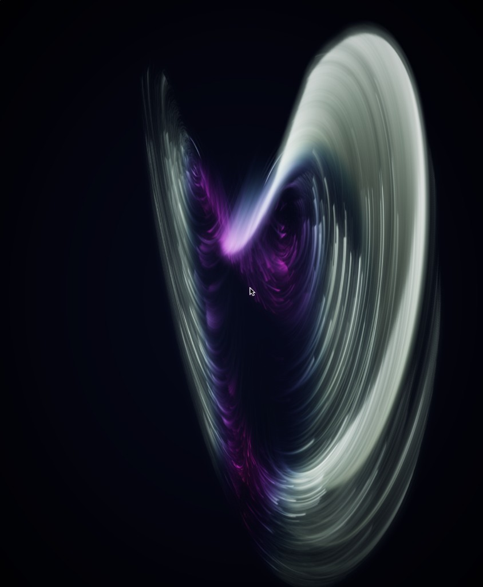

# CcinoGPU

**CcinoGPU** 是一个基于 **Vulkan 1.3** 与 **C++23** 的现代 GPU 渲染与计算框架。

写 Vulkan 最繁琐的地方往往不是渲染算法本身，而是无休止的 Descriptor Set 样板代码、手算 `VkImageMemoryBarrier2` 状态转换，以及在 C++ 与 GLSL 两套代码之间来回同步结构体布局。CcinoGPU 的目标很简单：**让你留在 C++ 里写完全部渲染和计算逻辑**——直接在 RenderGraph 的 Pass 中用 C++ Lambda 编写着色器，自然地捕获 C++ 变量，剩下的 AST 转译、SPIR-V 编译、Bindless/BDA 绑定和管线屏障全部交给框架处理。

<p align="center">
  
  <br />
  <em>内置示例 <code>Demo/ParticleGalaxy</code>：纯 C++ 编写的 4-Pass 管线，实时模拟并渲染 26 万个粒子在奇异吸引子中的流动轨迹（图为 Lorenz 吸引子）</em>
</p>

---

## 核心特性

- **用 C++ Lambda 直接写 Shader（Clang LibTooling 驱动）**
  无需手写和维护独立的 `.glsl` 文件。构建期 `CodeGenerator` 会通过 Clang LibTooling 解析 C++ 语法树，将 Pass 中的 Compute (`AddCS`)、Vertex / Fragment (`AddVSAndFS`) Lambda 以及调用的自由函数、自定义结构体自动降级为 Vulkan GLSL 460，并由 `shaderc` 编译为 SPIR-V。
- **零样板代码的自动反射与绑定**
  着色器 Lambda 按值捕获的 C++ 变量（标量、向量、矩阵、Buffer 访问器、纹理视图）会在编译期自动反射出内存布局，运行时自动打包上传，不再需要手动声明 `VkDescriptorSetLayout` 或逐字段对齐 `std140`。
- **全 Bindless 与 BDA（Buffer Device Address）底座**
  - **Buffer**：全部走 64 位设备地址（`bufferDeviceAddress`），着色器直接通过指针读写内存，不占任何 Descriptor 槽位。
  - **Texture & Sampler**：统一收纳在全局 `UPDATE_AFTER_BIND` 描述符数组中，以 32 位索引访问。
  - **8 字节 Push Constant**：每次派发/绘制仅推送当前飞行帧 Uniform Buffer 的 8 字节设备地址。
- **声明式 RenderGraph**
  通过 `Read` / `Write` / `ReadWrite`（Buffer）以及 `Sample` / `LoadUAV` / `StoreUAV` / `RTView`（Texture）声明资源读写意图，RenderGraph 自动完成资源版本追踪、Pass 拓扑排序，并生成精确的 `Synchronization2` 内存与布局转换屏障。
- **拥抱现代 Vulkan 扩展**
  图形管线基于 `VK_KHR_dynamic_rendering` 与 `VK_EXT_shader_object` 构建，告别臃肿的 `VkRenderPass`、`VkFramebuffer` 和管线状态组合爆炸。

---

## 代码长什么样？

在 CcinoGPU 中，CPU 侧的 Pass 编排和 GPU 侧的 Shader 逻辑写在同一个文件、同一个上下文里。

下面是一段完整的离屏渲染示例（摘自 `Demo/OfflineTriangle`）：无需顶点缓冲，直接在 C++ Lambda 中定义顶点与片元着色器，渲染到纹理并读回内存：

```cpp
Ccino::RGBuilder* builder = ctx.CreateRGBuilder("OfflineTriangle");
RID targetRID = builder->CreateExternalTexture2D(target);

builder->AddPass<"OfflineTrianglePass">([&](Ccino::RGBuilder& rg, RID& passRID) {
    Ccino::Vec4 red(1.0f, 0.0f, 0.0f, 1.0f);
    Ccino::Vec4 green(0.0f, 1.0f, 0.0f, 1.0f);
    Ccino::Vec4 blue(0.0f, 0.0f, 1.0f, 1.0f);

    // VS：按引用传参表示输出 (out)，按值捕获的 red/green/blue 自动打包进 Uniform
    auto vs = [=](Ccino::Vec4& color) {
        Ccino::Position = Ccino::Vec4(0.0f, -0.5f, 0.0f, 1.0f);
        color = red;
        if (Ccino::VertexIndex == 1) {
            Ccino::Position = Ccino::Vec4(0.5f, 0.5f, 0.0f, 1.0f);
            color = green;
        }
        if (Ccino::VertexIndex == 2) {
            Ccino::Position = Ccino::Vec4(-0.5f, 0.5f, 0.0f, 1.0f);
            color = blue;
        }
    };

    // FS：const 引用/传值表示输入 (in)，非 const 引用对应 RenderTarget 输出
    auto fs = [=](const Ccino::Vec4& color, Ccino::Vec4& outColor) {
        outColor = color;
    };

    auto renderTarget = rg.RTView(targetRID, passRID, Ccino::LoadOp::Clear, kClearColor);
    rg.AddVSAndFS(vs, fs, Ccino::GraphicsSetting{.drawCounts = 3}, {renderTarget});
});

ctx.Run("OfflineTriangle");
target->Readback(pixels.data());
```

---

## 内置示例（Demos）

`Demo/` 目录下包含三个从简到繁的示例程序，展示了不同场景下的框架用法：

### 1. `Demo/ParticleGalaxy` —— 奇异吸引子粒子星系（封面图来源）

单文件（`Demo/ParticleGalaxy/main.cpp`）实现的实时交互粒子系统。**262,144（`1 << 18`）个粒子**在四种经典混沌奇异吸引子（**Aizawa**、**Lorenz**、**Thomas**、**Halvorsen**）之间平滑流动与变形。每帧由 RenderGraph 串联四个 Pass 完成：

1. **`ParticleSimulatePass` (Compute)**：通过 BDA 原地读写粒子 Buffer，计算吸引子速度场插值、鼠标黑洞引力漩涡、径向冲击波以及粒子寿命重生。
2. **`ParticleFadePass` (Graphics)**：在跨帧保留的 `RGBA16_Float` HDR 纹理上用 Alpha 混合叠加时间衰减层，留下与帧率无关的丝滑拖尾。
3. **`ParticleDrawPass` (Graphics)**：不使用顶点缓冲，Vertex Shader 直接拉取粒子 Buffer 数据并在裁剪空间展开为广告牌面片（Billboard），根据粒子速率与外力热量进行余弦调色板着色，以加法混合写入 HDR 缓冲。
4. **`ParticleCompositePass` (Graphics)**：对 HDR 纹理进行 24 采样点的黄金角螺旋大半径 Bloom 柔光，叠加暗角与曝光控制后经 ACES 色调映射输出至 `RGBA8_sRGB`，最后 Blit 到窗口交换链。

**交互操作：**
| 按键 / 鼠标 | 功能 |
| :--- | :--- |
| **鼠标左键（按住）** | 在光标所在世界平面生成黑洞漩涡，卷吸周围粒子 |
| **鼠标右键** | 在光标位置释放径向冲击波 |
| **鼠标滚轮** | 缩放相机视距 |
| **`1` ~ `4` / `Tab`** | 在 Aizawa / Lorenz / Thomas / Halvorsen 四种吸引子之间平滑切换 |
| **`Space`** | 在中心触发一次爆发冲击波 |
| **`↑` / `↓`** | 调节画面曝光度（Exposure） |
| **`R` / `Esc`** | 重置所有粒子 / 退出程序 |

### 2. `Demo/SwapchainTriangle` —— 交换链实时渲染
演示带窗口与交换链的帧循环（`RGBuilder::LoopRun`）。每帧重跑 Pass 录制闭包以刷新 Uniform 中的旋转角度 `angle`，将旋转三角形绘制到离屏 `RGBA8_sRGB` 纹理后自动 Blit 到交换链显示，支持窗口大小动态调整与交换链重建。

### 3. `Demo/OfflineTriangle` —— 无窗口离屏渲染
不创建窗口和交换链（`bUseSwapChain = false`），执行单次 RenderGraph 将彩色三角形绘制到 `Texture2D`，通过 `Readback` 读回像素后直接写出为 `triangle.bmp`，适合做无头测试（Headless CI）与管线验证。

---

## 目录结构与设计文档

```text
CcinoGPU/
├── RHI/             # Vulkan 底层封装：Context、Swapchain、BDA Buffer、Bindless DescriptorSlot、Timeline 同步
├── Core/            # 面向用户的核心资源封装：Buffer、Texture2D、基础数学类型 (CcinoType) 与智能指针
├── RG/              # RenderGraph：Pass 注册、Accessor/Viewer 资源视图、依赖建图与自动 Barrier 生成
├── CodeGenerator/   # 基于 Clang LibTooling 的 C++ AST -> GLSL 460 源到源转译器与捕获布局反射
├── GLSLCompiler/    # 基于 shaderc 的 GLSL -> SPIR-V 运行期/构建期编译器
├── ShaderStruct/    # CodeGenerator 与运行时共享的 ShaderIR、UniformData 元数据定义
├── Context/         # 顶层入口 Ccino::Context，统筹 RHI、ShaderIR 注册表与 RGBuilder 生命周期
├── Demo/            # 示例程序（OfflineTriangle / SwapchainTriangle / ParticleGalaxy）
├── Tests/           # GoogleTest 单元测试与集成测试套件
└── Docs/            # 核心模块架构文档
```

如果你想深入了解内部实现细节，可以阅读 `Docs/` 下的设计文档：
- [CodeGenerator 架构设计（Clang AST -> GLSL AST 转译器）](Docs/CodeGenerator/CodeGenerator.md)
- [DescriptorSlot Bindless 与 BDA 绑定层设计](Docs/RHI/DescriptorSlot.md)

---

## 环境准备与构建指南

### 1. 拉取子模块

项目通过 Clang LibTooling 在构建期解析 C++ 源码，`ThirdPart/llvm-project` 固定在官方 `llvmorg-23.1.4` 版本。克隆仓库后请按父仓库记录的提交初始化子模块（**不要**加 `--remote` 随意升级）：

```bash
git submodule update --init --recursive
```

### 2. Linux 构建（Nix Flake / CMake + Ninja）

仓库根目录提供了开箱即用的 `flake.nix`，已配好 Clang、CMake、Ninja、Vulkan Loader / Validation Layers 以及 Wayland 相关依赖：

```bash
# 进入 Nix 开发环境（若使用 direnv 会自动加载）
nix develop

# 配置与编译
cmake -S . -B build/release -G Ninja -DCMAKE_BUILD_TYPE=Release
cmake --build build/release --parallel

# 运行 ParticleGalaxy 粒子星系 Demo
./build/release/Demo/ParticleGalaxy/ParticleGalaxy

# 运行测试套件
ctest --test-dir build/release --output-on-failure
```

### 3. Windows 构建（llvm-mingw + Ninja + Vulkan SDK）

在 Windows 下需要准备 **CMake 3.24+**、**Ninja**、**Python 3**、**Vulkan SDK**，以及与子模块版本匹配的 **llvm-mingw 23.1.4**（确保内嵌 LibTooling 与编译器的标准库头文件一致）。请根据本机安装路径调整以下命令：

```powershell
$env:VULKAN_SDK = 'C:\VulkanSDK\1.4.363.0'

cmake -S . -B build/release -G Ninja `
  -DCMAKE_BUILD_TYPE=Release `
  -DCMAKE_C_COMPILER=C:/Tools/llvm-mingw/bin/cc.exe `
  -DCMAKE_CXX_COMPILER=C:/Tools/llvm-mingw/bin/c++.exe `
  -DCMAKE_MAKE_PROGRAM=C:/Tools/ninja/ninja.exe `
  -DLLVM_PARALLEL_COMPILE_JOBS=4 `
  -DLLVM_PARALLEL_LINK_JOBS=1 `
  -DLLVM_PARALLEL_TABLEGEN_JOBS=2

cmake --build build/release --parallel 4
ctest --test-dir build/release --output-on-failure
```

编译并运行单个示例：

```powershell
# 运行奇异吸引子粒子 Demo
cmake --build build/release --target ParticleGalaxy
./build/release/Demo/ParticleGalaxy/ParticleGalaxy.exe

# 运行旋转三角形 Demo（可传入渲染帧数，不传则持续运行至按 Esc）
cmake --build build/release --target SwapchainTriangle
./build/release/Demo/SwapchainTriangle/SwapchainTriangle.exe

# 运行离屏三角形 Demo（输出 triangle.bmp）
cmake --build build/release --target OfflineTriangle
./build/release/Demo/OfflineTriangle/OfflineTriangle.exe triangle.bmp
```

> **提示**：由于着色器由构建目标 `GenerateShaderIR` 扫描源码自动生成，所有 Demo 和测试目标均已声明对该目标的依赖，直接 `--target <DemoName>` 构建即可自动触发 Shader 转译。若升级了工具链或 LLVM 版本，建议使用 `cmake --fresh` 重新配置构建目录。

---

## 当前进展与后续计划（Roadmap）

CcinoGPU 目前正处于活跃迭代阶段，核心的计算与图形渲染闭环已经跑通：

- [x] **C++ -> GLSL 四层转译器**：支持 Compute / Vertex / Fragment Lambda、自由函数、自定义结构体、成员函数及依赖拓扑排序
- [x] **Bindless & BDA 绑定管线**：Buffer 设备地址直访、全局纹理/采样器描述符池、飞行帧延迟回收机制
- [x] **RenderGraph 核心调度**：Buffer 与 2D Texture 读写版本追踪、自动 `VkBufferMemoryBarrier2` / `VkImageMemoryBarrier2` 注入
- [x] **图形管线与窗口呈现**：基于 `VK_EXT_shader_object` + Dynamic Rendering 的单轮图形 Pass、SDL3 窗口管理与交换链自适应重建
- [ ] **图形管线能力扩展**：RenderGraph 深度附件（`DepthAttachment`）接入、顶点/索引缓冲绑定、实例化（Instancing）与 Indirect Draw 支持
- [ ] **瞬态资源池（Transient Pool）**：实现 RenderGraph 内部瞬态纹理与缓冲区的生命周期复用及内存别名（Memory Aliasing）
- [ ] **更细粒度的同步与并行录制**：完善跨队列资源级 Timeline 回写，支持多线程 Command Buffer 并行录制
- [ ] **纹理特性补全**：支持多 Mipmap / Array Layer 拷贝、视图格式重解释（Format Reinterpretation）与着色器侧纹理数组访问

---

## License

本项目基于 [LICENSE](LICENSE) 开源。
